<div align="center">


# yami

A pixel-art desktop for niri, drawn in whole pixels.

[](https://github.com/Trendorin/yami/releases/latest)
[](docs/SECURITY.md#install-count)
[](LICENSE)


[Install](#installation) · [Screenshots](#screenshots) · [Settings](docs/CONFIG.md) · [Changelog](CHANGELOG.md) · [Русский](README.ru.md)

</div>

https://github.com/user-attachments/assets/1bdd1250-d04c-4993-b66f-0dc29b4512a5

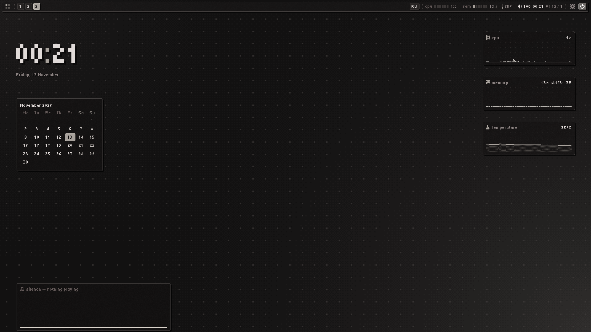

**yami** (闇, "darkness") turns the [niri](https://github.com/YaLTeR/niri) Wayland compositor into a
finished desktop: dark graphite, one accent colour, crisp unantialiased pixel fonts. Its own
shell, **yami-shell**, draws the bar, launcher, dock, notifications, lock screen, widgets and
settings itself, in Rust and shared memory, in one ~6 MB binary that uses **about 15 MB of RAM**.
Files, images, the login screen and every other app follow the same palette.

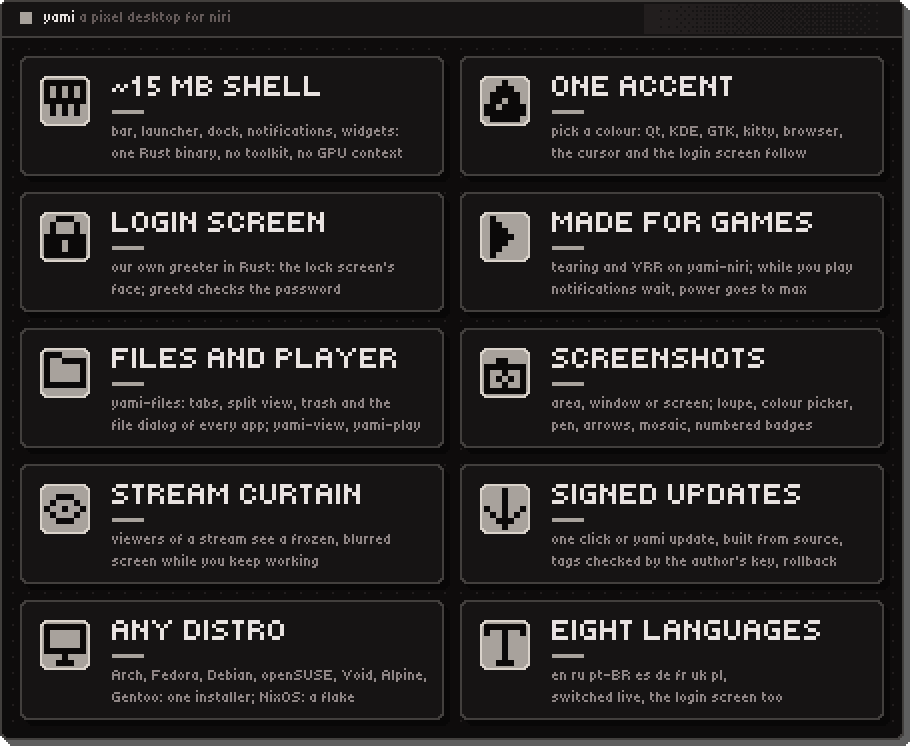

Install on any of eight distributions with one command, built from source:

```sh
bash <(curl -fsSL https://raw.githubusercontent.com/Trendorin/yami/main/install.sh)
```

Everything it does and its flags: [Installation](#installation).

## Features

- **Native and lightweight.** Software rendering into shared memory through layer-shell; no
  GPU context, no toolkit, no JavaScript. Fonts are memory-mapped, and redraws only happen when
  something changes.
- **Complete desktop shell.** Bar, app launcher with clipboard history, power menu, lock screen
  (PAM), notification server with history and do-not-disturb, OSD, system tray (StatusNotifierItem
  with DBusMenu), calendar, sound/music/network/Bluetooth/system popups, a power profile switch
  (power-profiles-daemon), Bluetooth devices paired, connected and forgotten right in settings, and its
  own **polkit password window** instead of a Qt/GTK agent. A privacy light on the bar says which
  program records the microphone, holds the camera or shares the screen. Right-click the bar for a
  control panel: clock, volume and brightness sliders, what is playing, quick tiles and the bar's edge.
  Notification cards and the volume OSD go to whichever corner you click on a screen map.
- **Desktop widgets.** Clock, calendar, weather, Bluetooth devices with their battery, the output of your own script, music card with an
  audio-reactive equalizer, and graphs
  for CPU, RAM, temperature and rx/tx network traffic in five styles (bars, line, blocks, wave,
  dots) and four animations. Drag them into place in edit mode (they stick to a grid, the screen centre and each other; Shift drags freely), hide or resize them. Widgets
  without a frame follow the wallpaper under them: dark text on a light spot, light on a dark one.
- **Pixel dock.** Pinned apps and open windows on any edge, window markers, a hover animation to
  choose (grow, wave, lift or none) that steps in whole pixels, a stepped bounce on launch; never, smart (empty workspace) or always hidden.
- **Screenshots.** `Print` freezes the screen under a pixel overlay: area, window or monitor, a
  loupe, pen, frame, arrow, marker, mosaic and numbered badges, a colour picker that copies hex,
  text recognition (tesseract) and QR codes (zbarimg) from the selection; copies
  and/or saves, the notification has a thumbnail and open / show-in-folder.
- **yami-files.** A file manager in the same pixels: tabs, split view, icons and details, places
  in your order (drag, hide, fold), devices that mount by themselves when plugged in (drives and
  cards through udisks2, encrypted ones with a password, phones and cameras over MTP/PTP, iPhone), network shares
  (smb, sftp, ftp, WebDAV, nfs: «connect to a server», addresses remembered without passwords), freedesktop trash, copy/move with progress and conflicts, undo, drag and
  drop, thumbnails, open with. It is also the **file dialog** of every app that uses the portal
  (Firefox, LibreWolf, Chromium, Telegram, Electron, GTK/KDE apps) and answers **show in folder**.
- **Screen sharing.** OBS, Discord/Equibop and browsers get a pixel «what to share» window from the
  shell (monitors and windows); the stream itself comes from niri, through the yami portal.
- **yami-view.** A fast image viewer and quick editor (rotate, flip, crop, save as, wallpaper),
  real pixels when zoomed, GIF/WebP animation. Photo viewers open as floating windows.
- **yami-play.** A video and music player in the same pixels: every format ffmpeg knows,
  hardware decoding, subtitles and audio tracks, a cell timeline, folder playlist in natural
  order, resume where you stopped, speed, frame step, saving a frame, a «pixel» scaling mode.
  libmpv is loaded at run time (the only dependency); the screen stays on while a video plays.
- **Screens.** Settings → screens: drag monitors into place, pick resolution, refresh rate, scale,
  rotation and VRR; applied through `~/.config/yami/niri/outputs.kdl`, reverted after 15 s unless kept.
- **Login screen.** Our own: yami-greet draws the lock screen's face inside niri, greetd (a 650 KB
  daemon in Rust) checks the password and starts the session. No Qt, no SDDM. It follows the shell:
  palette, wallpaper, language, monitors, keyboard layouts; if it ever cannot start, greetd's text
  login takes that one boot, so the machine always lets you in. Settings → system → login screen:
  its wallpaper, veil, clock, user list, power buttons, a preview and how its last start went.
- **Desk mode.** Toggle niri between tiling and a classic floating desktop with DE-style title
  bars, a resize corner on every window, click to focus and raise, minimize/restore and a task
  list in the bar.
- **yami-niri.** Our niri: upstream 26.04 plus a short patch series, built for your CPU (fat
  LTO, `target-cpu=native`): tearing for fullscreen games (async page flips, less input lag), a
  realtime compositor thread so a game loading every core doesn't make the desktop stutter. The
  packaged niri stays as an automatic fallback. See [yami-niri](https://github.com/Trendorin/yami-niri).
- **Games.** Settings → games: game windows open fullscreen with VRR (and tearing on yami-niri),
  a big shader cache; while a game has focus notifications wait quietly and the power profile
  switches to «performance»; the shell stops redrawing what the game covers. It finds and uses what
  the system has on any distro: ntsync for Proton, GameMode for the focused game, MangoHud in the
  palette (`yami doctor games` lists it all).
- **Every key rebindable.** Settings → keys: all niri and shell bindings by category, press the
  new keys right there (even ones niri itself uses), conflicts are freed and named, add your own
  commands. Keyboard layouts too: by default they follow the system languages (an English system
  gets `us`, a Russian one `us,ru`), any xkb codes and the switch combination are a choice. Written
  to `~/.config/yami/niri/binds.kdl`.
- **One palette everywhere.** Seven presets or any custom accent recolor the shell, wallpaper,
  niri borders, kitty, foot, cava, starship, btop, fastfetch (闇 logo), Qt/KDE and GTK apps, the browser's menus (its
  own theme stays yours), the pixel cursor and the login screen at once; your own templates
  (`~/.config/yami/templates`) recolour any other app. App icons in the launcher, dock, file manager and tray are
  redrawn as 16×16 pixel art in the palette tones (can be turned off).
- **Qt and KDE apps look like the shell.** Notched buttons, fields, checkboxes and tabs drawn from
  the palette (qt6ct + QSS, KDE apps kept on Fusion instead of Breeze), and their file dialogs open
  in yami-files through the portal, like GTK apps and browsers (Tor Browser included).
- **A curtain for streams.** Mod+Shift+H: viewers of a stream, a Discord demo or an OBS recording
  see the frozen screen blurred (or in big pixels, or just the wallpaper), while you keep your
  desktop and a small «hidden» badge. A single shared window is covered too, and notifications
  never reach a recording (settings → services). Settings → screenshots. Needs yami-niri
  (`show-only-in`, `hide-from`); on other niri the windows turn black in the stream instead.
- **Your wallpaper.** Settings → wallpaper: pick an image from a grid of your wallpaper folder's
  thumbnails (or «set as wallpaper» in yami-files and yami-view), fill or fit, pixel cells, recolour it into the accent or the palette tones, darken
  it, or let the palette follow the image. The login screen gets the same picture. With
  [skwd-wall](https://github.com/liixini/skwd-wall) its picks (videos and Wallpaper Engine scenes
  too) become the wallpaper and its palette recolours the rice; nothing to configure on its side.
- **Your bar, any edge.** Top, bottom, left or right: click an edge on the screen map in settings →
  bar → look. A side bar is a column with every module drawn narrow (the clock as hours over
  minutes, icons instead of labels, windows as icons), and popups, menus, the dock and the widgets
  open beside it. Full-width strip, a centred panel of any length, or a floating pill with a gap and
  a shadow; the centre modules sit dead centre. Windows can get rounded corners and any border
  width (games stay square).
- **Crisp on any screen.** The shell, yami-files and yami-view render at the monitor's real scale
  (fractional-scale + viewporter) and upscale their pixels by nearest neighbour, so a 4K screen at
  scale 2 shows sharp 2×2 pixels instead of a compositor-smeared image. Tiny5 is drawn on its 8 px
  grid with no antialiasing (16/24/32 px by screen size).
- **Your fonts.** Settings → fonts: any font for the shell, separately for yami-files and
  yami-view, for GTK/Qt apps (readable sans by default, or pixel everywhere) and the terminal.
- **Pixel motion.** Panels and windows dissolve in on a Bayer dither grid, matching niri's custom
  window-open shaders. Settings → look offers four more patterns (scanlines, noise, diagonal,
  blocks), the cell size, an instant close and CRT scanlines over the panels.
- **Light or dark.** One switch (settings → color, or `install.sh --theme light`) turns the whole
  rice light: the shell, GTK/Qt/KDE, kitty, the cursor, the lock and login screens.
- **A launcher that does more.** Type `2+2*3` for an answer, an app or a window title, `vrr` to land
  on that setting, `>cmd` to run a command, `/name` to find a file at home.
- **Your own bar modules.** Any script in `~/.config/yami/scripts/` that prints text or JSON
  becomes a module or a desktop widget (crypto, GitHub, anything); weather is built in (Open-Meteo,
  bar module and widget); see [docs/CONFIG.md](docs/CONFIG.md).
- **Small comforts.** Reply to a message right from its notification, a night light (wlsunset),
  the programs of your last session reopened at login (opt-in), your themes one click away
  (settings → color → themes), shared as one file or a link (`yami theme export | import`) and the
  whole setup moved to a new system (`yami export | import`).
- **Eight interface languages.** English, Russian, Brazilian Portuguese, Spanish, German, French, Ukrainian and Polish, switchable live in settings; the modules, the login screen and the installer speak them too.
- **Portable installer.** One script for Arch, Fedora (including atomic), Debian/Ubuntu,
  openSUSE, Void, Alpine, Gentoo and NixOS.

## Screenshots

Real screenshots of a yami session (`tools/readme-shots.sh`).

**Login screen** · our own greeter: the lock screen's face, greetd checks the password

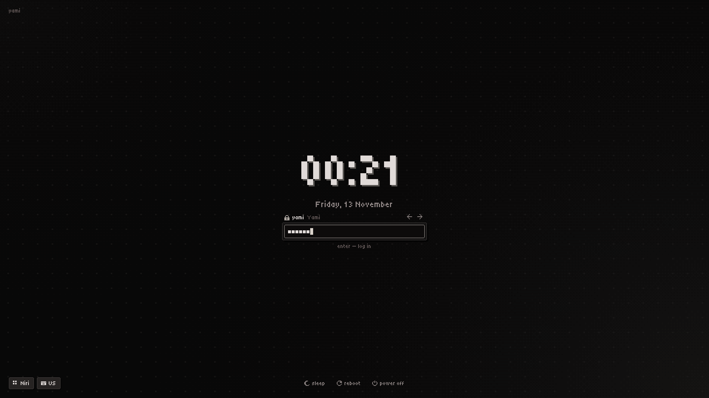

**yami-files** · thumbnails, places, tabs and split view; the file dialog of every app

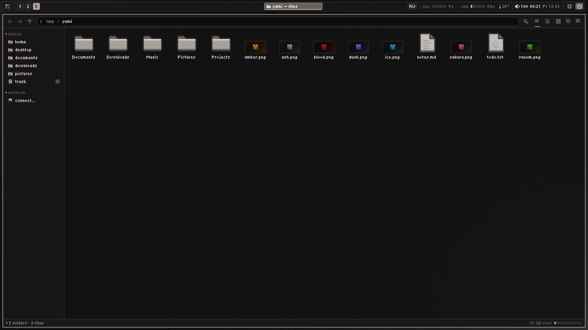

**Screenshots** · area, window or screen, then arrows, frames, marker, mosaic and badges

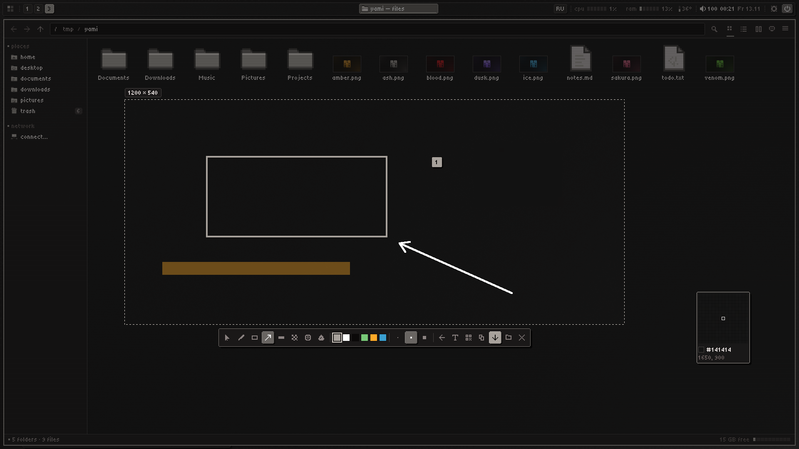

**Settings → colour** · seven palettes or your own accent, the whole desktop follows

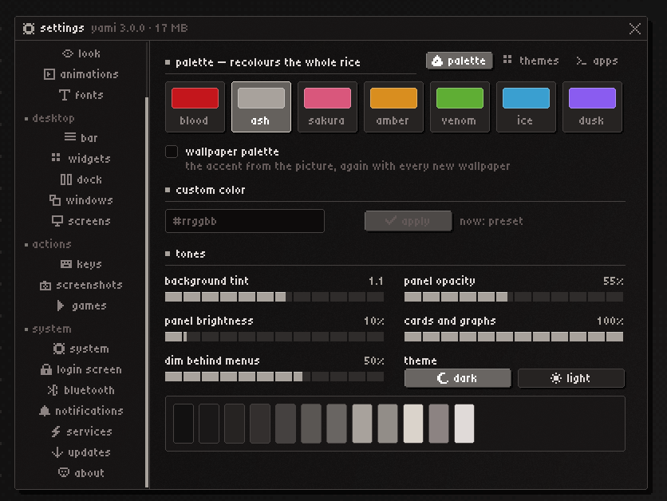

**Settings → keys** · every binding by category, recorded live

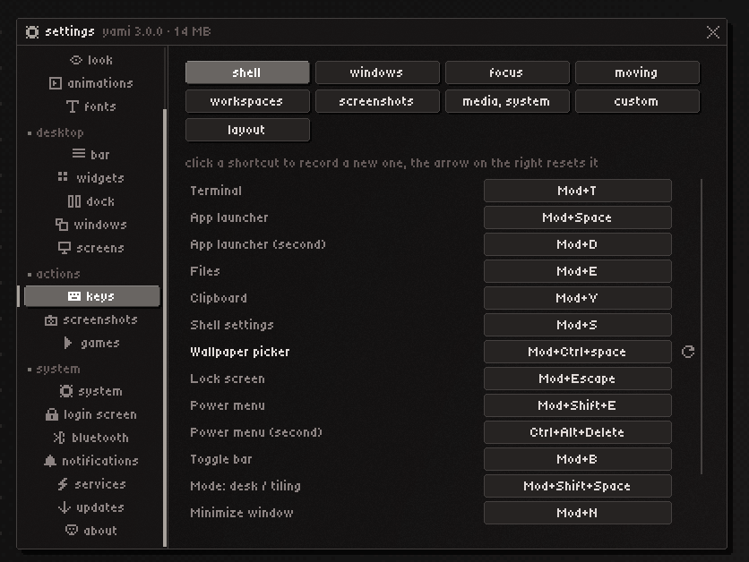

**yami-view** · real pixels when zoomed, quick edits, set as wallpaper

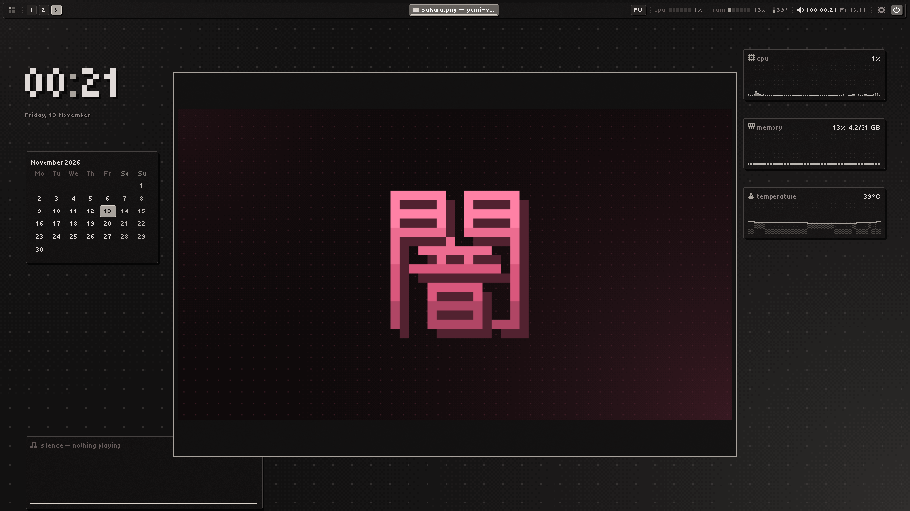

<details>
<summary><b>More screenshots</b></summary>

**Settings → updates** · releases, signatures, rollback

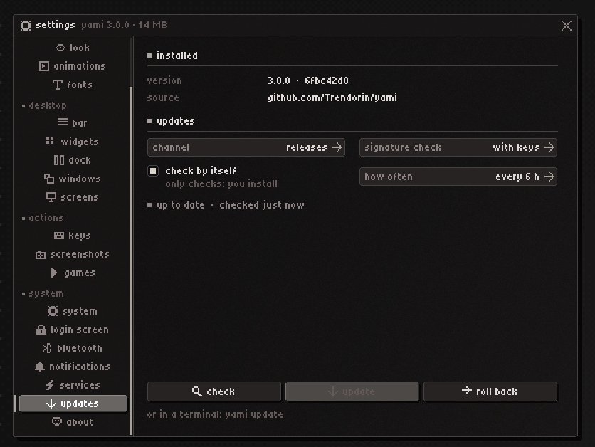

**Settings → services** · hand any of them to another program

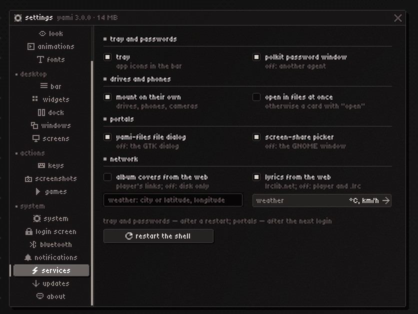

**Sound popup** · outputs, volume, microphone

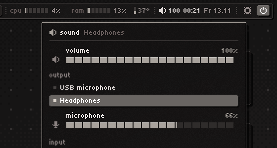

**The desktop** · bar, widgets and the launcher on the pixel wallpaper

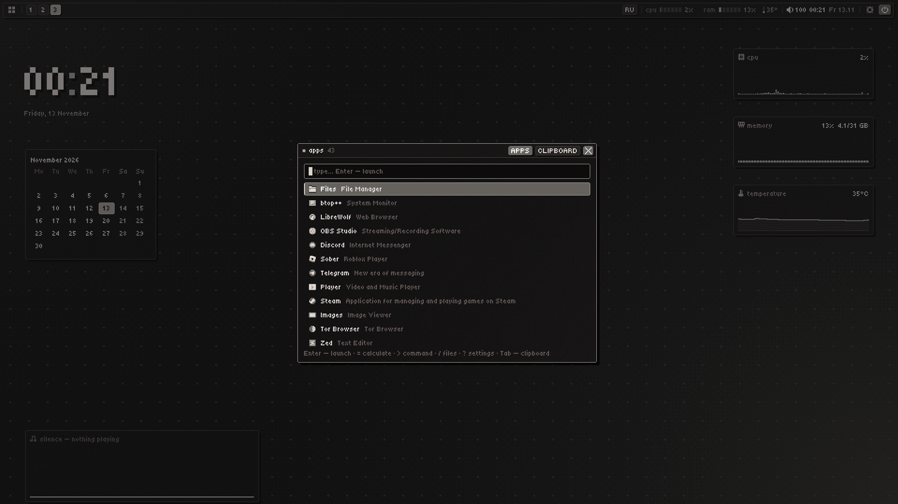

</details>

## Installation

One command on a fresh system (it fetches the repository into `~/.local/share/yami/src` and runs
the installer from there):

```sh
bash <(curl -fsSL https://raw.githubusercontent.com/Trendorin/yami/main/install.sh)
```

or from a checkout: `git clone https://github.com/Trendorin/yami yami && yami/install.sh`.

On x86_64 with glibc 2.34 or newer (Ubuntu 22.04, Debian 12, Fedora 35 and everything newer) a release installs
ready binaries with a checked signature: no compiler, a few minutes. Anywhere else it builds from source. Packages for
Arch, Debian, Fedora, Gentoo and Nix: [docs/PACKAGING.md](docs/PACKAGING.md).

It installs only the base: niri, the shell, a terminal and what the desktop cannot start without. Run it as
yourself, not with sudo: it asks for the password once, where it is needed, and before anything else it says
how long it will take and how much disk it needs. Then log out and pick the **Niri** session (no login screen
on this system: type `niri-session` in the console). The first-run setup meets you there, one topic per screen with every setting of it a click away: the language and style, colour, wallpaper, look, fonts, bar, dock, widgets, windows, keys, niri,
notifications and services, then which [modules](#modules) to add. Open it again at any time with `yami setup`. Running the
same command again later updates and repairs what is there and keeps your choices.

No flag is needed for a normal install; these are for the rest:

| Flag | Effect |
|---|---|
| `--yes` | no questions |
| `--full` | everything now, no first-run setup at the first login |
| `--apply "files view …"` | install exactly these modules (what the first-run setup runs) |
| `--lang en\|ru\|pt-BR\|es\|de\|fr\|uk\|pl` | language of the installer, the shell and the key hints |
| `--palette ID` | `blood` `ash` `sakura` `amber` `venom` `ice` `dusk` |
| `--look ID` | panels: `matte` `glass` `light` `solid` |
| `--font sans\|pixel` | app font: readable sans (default) or the pixel Tiny5 everywhere |
| `--fetch mini\|full` | fastfetch: who, system and desktop (default) or with the hardware too |
| `--no-ID`, `--ID` | with `--full`: a module off or on |
| `--restyle LIST` | what yami restyles: `all`, `none` or a list of `gtk` `qt` `cursor` `kitty` `fastfetch` `btop` `firefox` `mangohud` `foot` `cava` `starship`; a program left out is never touched (later: settings → color → apps) |
| `--no-sudo` | home directory only: no packages, no system files |
| `--from-source` | build everything here instead of taking the release's ready binaries |
| `--main` | the head of the development branch instead of the newest release (builds from source) |
| `--prebuilt DIR\|URL` | take the ready binaries from this folder or address |
| `--dry-run` | print the plan, change nothing |
| `--no-count` | do not add this machine to the «installs» badge (one anonymous request, [details](docs/SECURITY.md#install-count)); `DO_NOT_TRACK=1` does the same |
| `--uninstall` | remove yami and its modules, restore the backups and the previous login manager |
| `--update` | rebuild from this tree keeping every setting, no sudo (what `yami update apply` runs) |
| `--no-anim` | disable the installer animations |

What the base install does:

1. Detects the distribution from `/etc/os-release` and installs niri, portals, polkit, PipeWire,
   NetworkManager, BlueZ, power-profiles-daemon, Noto fonts, cliphist, grim, kitty, btop and the night
   light with its native package manager, in one transaction. Names a repository does not carry are reported, not fatal. Enables Bluetooth
   and power profiles, and NetworkManager when nothing else manages the network.
2. Puts the release's ready binaries into `~/.local/bin` after checking their signature, or builds
   the shell with `cargo build --release --locked` (Rust ≥ 1.89; rustup is used when the
   distribution's toolchain is older) when there are none for this system.
3. Installs the pixel fonts (Tiny5, DotGothic16, Terminess).
4. Connects yami to niri's config with one include line at its top (your config stays yours, what
   you write below the line wins); without a config, or with niri's own starting one left as it was, it
   writes yami's starting config and keeps the old file as `config.kdl.bak-yami-DATE`.

yami stays out of your drivers and your boot: no session environment for a driver, no module
options, no initramfs. Everything is logged to `~/.cache/yami/install.log`. On NixOS use the flake
instead: a NixOS module for the system half and a Home Manager module for the home half
([docs/PACKAGING.md](docs/PACKAGING.md#nix)).

### Building the shell by hand

```sh
cd shell
cargo build --release --locked
install -Dm755 target/release/yami-shell ~/.local/bin/yami-shell
```

Runtime libraries: `libxkbcommon`, `libpam`. Optional helpers: `pactl`/`parec` (volume, mixer,
equalizer), `playerctl` (media), `nmcli` (Wi-Fi), BlueZ (Bluetooth), `cliphist` and
`wl-clipboard` (clipboard). Nothing is written in Python any more: the palette export is part of the shell.

## Modules

The programs around the shell are separate, each in its own repository. The first-run setup adds and
removes them, and any of them works without the yami shell: take one into your own setup with
one file and `./yami-files install`, no root needed. The shell's own services, yami-agents (the polkit
and drive password windows, the screen-share picker and portal, automount), come with the shell from
this repository; they run as their own process, so restarting the shell never stops a stream.

| Module | What | Needs |
|---|---|---|
| [yami-files](https://github.com/Trendorin/yami-files) | file manager, the file dialog of every app, «show in folder» | any Wayland compositor |
| [yami-view](https://github.com/Trendorin/yami-view) | image viewer and quick editor | any Wayland compositor |
| [yami-play](https://github.com/Trendorin/yami-play) | video and music player | libmpv |
| [yami-shot](https://github.com/Trendorin/yami-shot) | screenshots: freeze, select, mark up, read text and QR | layer-shell, grim |
| [yami-greet](https://github.com/Trendorin/yami-greet) | the login screen | greetd, niri |
| [yami-niri](https://github.com/Trendorin/yami-niri) | niri with tearing for games and a realtime thread | a build from source |

Their system packages come with them: drives and phones (udisks2, gvfs) with yami-files and the shell,
text and QR recognition with yami-shot. With Steam on the machine the first-run setup also offers `games`
(GameMode, MangoHud).

Every module draws through [yami-px](shell/px), the drawing library in this repository (a module takes
it by the tag `px-vX.Y.Z`), and reads one look: `~/.config/yami/style.json`
for all of them, `style.<module>.json` for what one does differently. Outside yami a module is
neutral: the system font, rounded corners, soft shadows. The pixel look of the shell is the preset
`yami`, and the keys go down to every colour: [docs/CONFIG.md](docs/CONFIG.md#the-look-of-every-module).

## Resource usage

Measured on this setup (1920×1080, Arch, PSS — shared library pages split fairly; RSS in brackets):

| What | Memory |
|---|---|
| yami-shell, idle (bar, dock, widgets, notifications, tray) | 12.5 MB (16 MB) |
| yami-shell with the settings open | 18 MB |
| yami-shell during a screenshot (frozen frame), freed on close | 32 MB → 16 MB |
| yami-files --portal (file dialog + FileManager1 service, always on) | 0.8 MB (3.2 MB) |
| yami-files window on the home folder | 11 MB (14 MB) — Dolphin: 69 MB (161 MB) |
| yami-view on a 1080p PNG, both neighbours decoded ahead | 49 MB (53 MB) — Gwenview: 96 MB (188 MB) |
| binaries on disk: shell + files + view + player | 8.7 + 6.4 + 2.3 + 1.6 MB |

Always running: about 13 MB for the shell and the portal together. No GPU context, no toolkit,
no interpreter; windows are drawn into shared memory and only when something changes. Code a
program has stopped running (its start-up, a closed settings window) goes back to the kernel.

## Keys

| Keys | Action |
|---|---|
| `Mod+Space`, `Mod+D` | launcher (`Tab` switches to the clipboard) |
| `Mod+V` | clipboard: `Ctrl+P` pin, `Del` delete |
| `Mod+S` | shell settings |
| `Mod+T` | kitty |
| `Mod+Shift+Space` | desk mode ↔ tiling |
| `Mod+N`, `Mod+Shift+N` | minimize window, restore the last one |
| `Mod+Q`, `Alt+F4` | close window |
| `Mod+F`, `Mod+Shift+F` | maximize column, fullscreen |
| `Mod+G` | toggle floating |
| `Mod+Tab` | overview |
| `Alt+Tab`, ``Alt+` `` | recent windows, windows of the same app |
| `Mod+1…9`, `Mod+Shift+1…9` | focus workspace, move column there |
| `Mod+arrows`, `Mod+HJKL` | focus; with `Ctrl` move |
| `Print`, `Mod+Shift+S` | screenshot overlay; `Ctrl+Print` monitor, `Alt+Print` window |
| `Mod+E` | yami-files |
| `Mod+Escape` | lock |
| `Mod+Shift+E`, `Ctrl+Alt+Del` | power menu |
| `Mod+B` | hide the bar |
| `Mod+Shift+/` | all key bindings |
| `Alt+Shift` | next keyboard layout (settings → keys → layout) |

These are the defaults: change any of them in settings → keys (`yami-shell binds list` prints the
current set).

In the bar: right click on an empty spot opens the control panel; left click on a task focuses,
minimizes and restores it, middle click closes, right click opens the window menu; scroll over workspaces to switch, over the volume to change it. The
track opens the player (drag its position bar to seek), right click pauses, middle click skips;
the button in the player's header switches it between the cover with the equalizer, the cover
with lyrics, lyrics alone (the sung line lit when the lyrics have timestamps) and a short view.

## The `yami` command

One command for the whole desktop (`~/.local/bin/yami`, the same binary as `yami-shell`);
`yami help` prints it in the palette's colours, `yami help <command>` explains one.

```sh
yami open settings:keys       # launcher clipboard settings[:tab] power lock walls screenshot cal sound media net bt sys profile tray weather privacy
yami palette ash              # list palettes without an argument; a colour: '#3a9fd0'; or wallpaper
yami wallpaper ~/x.png        # own wallpaper; no path: the palette's pixel art
yami restart                  # restart the shell (waits while a game has focus)
yami status                   # what runs: shell, portal, niri, the last update check
yami doctor                   # which programs and D-Bus services are there, what is missing and what it costs
yami doctor games             # ntsync, gamemode, MangoHud: what is there, how to add the rest
yami report                   # an archive for an issue: versions, doctor, journal, configs without secrets
yami ocr image.png            # text from an image (like «text» in the screenshot overlay)
yami theme export ~/my.yami   # the look as one file (import: yami theme import FILE or https link)
yami theme save night         # keep the current look in your themes (list | apply NAME | remove NAME)
yami templates                # render your templates, show what came out (force NAME overwrites one)
yami icons add ~/Downloads/set.tar.xz   # install an icon or cursor set (yami icons NAME, yami cursor NAME)
yami export ~/all.yami        # every setting as one file for a new system (yami import FILE)
yami version                  # every part, the installed commit, the update channel
yami update                   # what is new; apply | list | to X.Y.Z | rollback | status | log | need
```

## Updates

Settings → updates (or `yami update`) checks the repository once a day and shows a card when a
release is out; installing is always your click. The updater keeps its own clone in
`~/.local/share/yami/src`, builds the new version from source with `install.sh --update`
(settings kept, no sudo). Nothing changes until every part has built, a failed update puts everything back by
itself, and `yami update rollback` returns the programs and configs from before the last update. Channels:
**releases** (`vX.Y.Z` tags) or **every commit** of `main`. The tab shows a small console with the
update log and a progress bar while it runs. An update needs no sudo, so when a new version wants
packages (a new feature's helper) the tab shows them with an **install** button that runs one
`sudo` command in a terminal (`yami update need`, also in `yami doctor`).

Going back is a choice, not a single click: **roll back** opens a list with the previous build
(instant) and the signed releases (`yami update list`, `yami update to 2.1.0`), and only
**install** starts it. Settings an older version does not know are kept aside and come back
when you update again; after any switch the updater makes sure the shell is running.

Releases are signed: once `keys/allowed_signers` holds the author's key, the installed version
accepts only tags signed with it, so a pushed or rewritten tag without the key does not install.
For maintainers:

```sh
tools/release.sh --keygen     # once: an ssh signing key, trusted in keys/allowed_signers (commit it)
tools/release.sh 2.1.0        # CHANGELOG «Unreleased» → 2.1.0 (both languages), versions, check.sh, signed tag, push
```

Updates come from this repository over HTTPS; set `updateRepo` to follow a fork instead.

## Configuration

Everything in settings (`Mod+S`) is also a key in `~/.config/yami/shell.json`, reloaded live when
edited by hand; one bad value falls back to its default instead of resetting the file. The full
reference is [docs/CONFIG.md](docs/CONFIG.md). From the terminal:

```sh
yami-shell config list                 # every key, * marks what differs from the default
yami-shell config set dockSide '"left"'
yami-shell config set binds '{"terminal": "Mod+Return"}'
yami-shell config check                # bad values and unknown keys
yami-shell binds list                  # keybindings: id, keys, action
```

- **Settings tabs**: color, wallpaper, look, animations, fonts, bar (the screen edge on a map, drag module
  chips and separators; spacing at the edges, between modules and around the windows with arrows), widgets,
  dock, windows (gaps between windows and from the screen edges, floating rules, cursor), screens, keys,
  screenshots, games, system, login screen, Bluetooth, notifications (where the cards and the OSD go, on a
  map), services (tray, polkit, portals, covers: each can be handed to another program), updates.
- **niri**: your `~/.config/niri/config.kdl` stays yours: yami adds one include line at its top
  (`yami niri connect`, `yami niri disconnect` takes it out), and what you write below it wins. The
  line brings `~/.config/yami/niri/yami.kdl`: the shell's keys (`binds.kdl`), window rules, blur and
  games (`rules.kdl`), colours and cursor, screens (`outputs.kdl`) and yami's niri look (`base.kdl`),
  each switched in settings → system → niri.
- **IPC**: `yami-shell msg <command>`, where the command is one of `launcher`, `clipboard`,
  `power`, `settings`, `lock`, `bar`, `stacking`, `minimize`, `restore`, `edit`, `reload`,
  `restart`, `quit`, `settings TAB`, `profile` (next power profile), `popup cal|sound|media|net|bt|sys|profile|tray`, `screenshot [area|window|screen]`,
  `walls` (the wallpaper picker), `wallpaper [PATH]` (no path: the generated pixel wallpaper), `curtain [on|off]` (privacy curtain), `cast-hide` (click a window: its app turns black in screen sharing, or visible again), `night` (night light on/off),
  `media play-pause|next|previous|player` (to the player the bar shows; `player` switches to the next one, as a click on its name in the music popup does).
- **yami-files**: `~/.config/yami/files.json` (also from its ≡ menu → settings). `yami-files
  --pick open|save|dir …` is the dialog the portal runs; `yami-files --portal` is the portal and
  FileManager1 service, started by D-Bus; `yami-files --portal-reload` hands it over to a newly
  installed binary without cutting a recording (the installer runs it).
- **Login screen**: `install-system.sh` of the yami-greet module builds it and installs it on a running
  system (sudo once), greetd from the next boot; the first-run setup does the same.
  `yami login sync` hands it the shell's look at once (the shell does that on every change).

## Repository layout

| Path | Contents |
|---|---|
| `shell/` | yami-shell, the Rust Wayland shell (cargo workspace) |
| `modules.lock` | which version of each module this version of the shell installs |
| `config/portal/` | which portal backend serves what |
| `config/niri/` | niri configuration (keybindings come from the shell) |
| `config/kitty/`, `config/fontconfig/` | terminal and pixel font rendering |
| `shell/px`, `shell/agents` | yami-px, the drawing library every module uses; yami-agents, the shell's services |
| `tools/apply-theme.sh` | fonts and widget style for Qt and GTK |
| `fonts/` | bundled pixel fonts (SIL OFL) |
| `install.sh`, `installer/` | the installer: the entry and the order of its steps, one module per job |
| `flake.nix`, `nix/` | the Nix package and the NixOS and Home Manager modules |
| `docs/` | configuration reference, security notes, packaging and Nix (each also in Russian: `*.ru.md`) |
| `keys/` | release signing keys (`allowed_signers`), read by `yami update` and the installer |
| `VERSION`, `CHANGELOG.md` | the release version and what changed in each release (`CHANGELOG.ru.md` in Russian) |

## yami-niri

Upstream niri v26.04 plus a short patch series, built on your machine. It lives in its own
[repository](https://github.com/Trendorin/yami-niri); the first-run setup builds and enables it, by hand from a clone of it:

```sh
./yami-niri.sh build     # fetch, patch, build (5–25 min), enable from the next login
./yami-niri.sh status    # which niri the next login starts
./yami-niri.sh off       # back to the packaged niri
```

The session starts it through a wrapper that falls back to the packaged niri when the fork rejects
the config or dies right after the start. If the session still does not come up: `Ctrl+Alt+F3`,
log in, `~/.local/lib/yami-niri/yami-niri.sh off`.

## Development

| Command | Does |
|---|---|
| `tools/check.sh` | build without warnings, i18n checks, the English and Russian docs in step (`yami-dev check-docs`), script syntax, niri config, installer dry run (CI runs it too) |
| `tools/map.sh [TEXT]` | every source file with its one-line description |
| `yami-shell shot [TARGET…] --lang en [--transparent] -o DIR` | render panels to PNG without a compositor; fails on untranslated text |
| `yami-agents shot`, `yami-files shot`, `yami-view shot`, `yami-play shot`, `yami-shot shot` | the same for each module (the first-run setup is the shell's `welcome:STEP` targets) |
| `tools/check-modules.sh [NAME…]` | every module next to this repository: no warnings, tests, translations, every state in both looks and every language, every text fits |
| `yami-greet shot -o DIR`, `yami-greet --demo` | the login screen offscreen in each state; `--demo` runs it without greetd (password `yami`) inside a nested niri |
| `yami-dev readme-art`, `tools/readme-shots.sh` | the README's logo and cards; real screenshots of your session (empty workspace, plain device names, everything put back) |
| `tools/release.sh X.Y.Z` | cut a release: changelog, versions, check, signed tag, push (`--keygen` once for the key) |
| `tools/deploy.sh` | build, install to `~/.local/bin` and restart the running shell (refuses while a game has focus); `--modules` adds the modules next to this repository, `--modules-only` installs only them |

## Thanks

- [Minish777](https://github.com/Minish777) hunts bugs and gaps and writes them up with fixes to
  pick from: player switching, lyrics, the wallpaper picker, the floating bar, weather, app
  templates and more started as those reports, and so did the template audit (#27), the windows
  module in any bar group (#28) and the palette from the wallpaper (#26).

## Made with Claude

yami is written with the help of [Claude](https://claude.ai) by Anthropic, through Claude Code:
much of the code, the yami-niri patches and the docs came out of those sessions. Every change is
still built, checked (`tools/check.sh`) and used every day on a real machine before it ships.

## License

Code: MIT, see [LICENSE](LICENSE). You may use, change and share it, in your own projects too,
as long as every copy and every substantial part of it keeps the copyright line and the license
text. Bundled fonts keep their own licenses (SIL Open Font License, texts in `fonts/`). Monocraft
is downloaded from its upstream release at install time (pinned version, checked against its
SHA-256). yami-niri is built from upstream niri (GPL-3.0)
with the patches of the yami-niri repository.

The license is for the code and gives no rights to the project's name: a fork or a rebuild goes
under its own name and logo and does not present itself as yami or as made by its authors.
