<div align="center">


# yami

Пиксельный рабочий стол для niri — целыми пикселями.

[](https://github.com/Trendorin/yami/releases/latest)
[](docs/SECURITY.ru.md#счётчик-установок)
[](LICENSE)


[Установка](#установка) · [Скриншоты](#скриншоты) · [Настройки](docs/CONFIG.ru.md) · [Изменения](CHANGELOG.ru.md) · [English](README.md)

</div>

https://github.com/user-attachments/assets/1bdd1250-d04c-4993-b66f-0dc29b4512a5

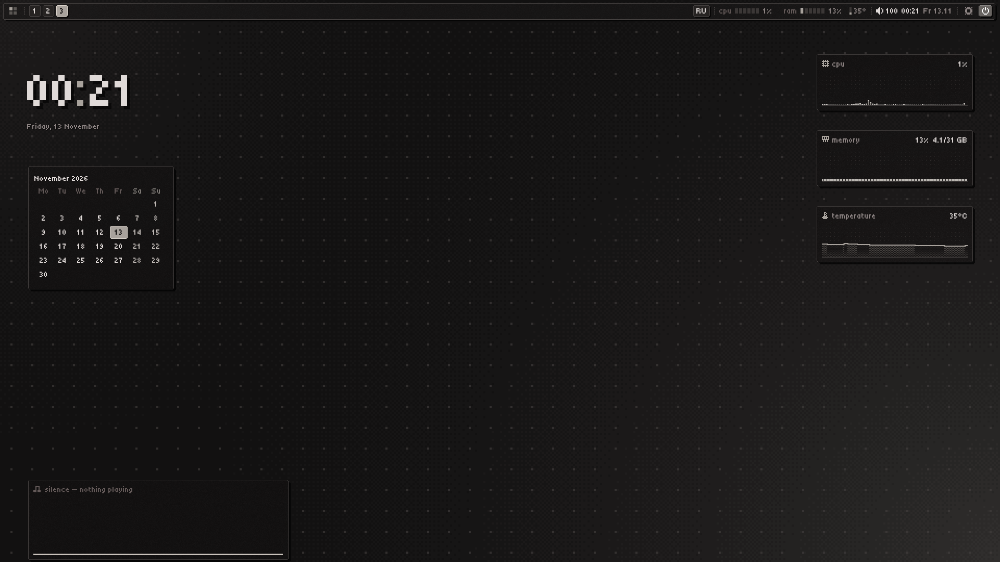

**yami** (闇, «тьма») превращает Wayland-композитор [niri](https://github.com/YaLTeR/niri) в
готовый рабочий стол: тёмный графит, один акцентный цвет, чёткие пиксельные шрифты без
сглаживания. Свой шелл, **yami-shell**, сам рисует бар, меню программ, док, уведомления, экран
блокировки, виджеты и настройки — на Rust, в общую память, одним бинарником на ~6 МБ, которому
хватает **около 15 МБ памяти**. Файлы, картинки, экран входа и все остальные программы — в той же палитре.

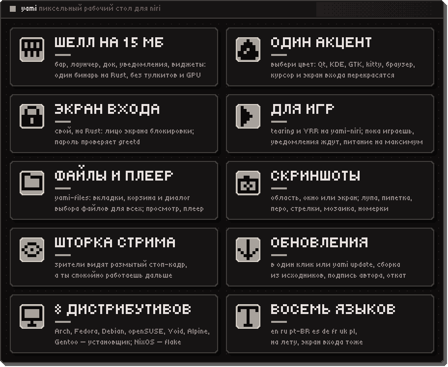

Ставится на любой из восьми дистрибутивов одной командой:

```sh
bash <(curl -fsSL https://raw.githubusercontent.com/Trendorin/yami/main/install.sh)
```

Что он делает и его флаги — в разделе [Установка](#установка).

## Возможности

- **Нативно и легко.** Программная отрисовка в разделяемую память через layer-shell: без
  GPU-контекста, тулкитов и JavaScript. Шрифты отображаются в память через mmap, перерисовка —
  только когда что-то изменилось.
- **Полноценный шелл.** Бар, меню программ с историей буфера обмена, меню питания, экран
  блокировки (PAM), сервер уведомлений с историей и режимом «не беспокоить», OSD, трей
  (StatusNotifierItem с DBusMenu), календарь, всплывающие панели звука, музыки, сети, Bluetooth и системы,
  переключатель профиля питания (power-profiles-daemon), устройства Bluetooth, которые сопрягаются,
  подключаются и забываются прямо в настройках, и своё **окно пароля polkit** вместо Qt/GTK-агента. Индикатор приватности в баре говорит, какая
  программа пишет микрофон, держит камеру или показывает экран. ПКМ по бару — панель управления: часы,
  ползунки громкости и яркости, что играет, быстрые плитки и край бара. Карточки уведомлений и OSD
  громкости встают в тот угол, который щёлкнешь на схеме экрана.
- **Виджеты рабочего стола.** Часы, календарь, погода, устройства Bluetooth с зарядом, вывод своего скрипта, карточка музыки с
  эквалайзером по звуку, графики
  процессора, памяти, температуры и сетевого трафика rx/tx: пять стилей (столбики, линия, клетки,
  волна, точки) и четыре анимации. Расставляются мышью в режиме редактирования (липнут к сетке, середине экрана и друг к другу; с Shift — свободно), прячутся,
  меняют размер. Виджеты без подложки подстраиваются под обои: на светлом месте текст тёмный,
  на тёмном — светлый.
- **Пиксельный док.** Закреплённые программы и открытые окна у любого края, огоньки окон,
  анимация при наведении на выбор (рост, волна, подъём или без неё) целыми пикселями, прыжок
  при запуске; прятать: никогда, умно (пустой стол), всегда.
- **Скриншоты.** `Print` замораживает экран под пиксельным оверлеем: область, окно или монитор,
  лупа, перо, рамка, стрелка, маркер, мозаика, номерки, пипетка (hex в буфер),
  распознавание текста (tesseract) и QR-кодов (zbarimg) с выделения; в буфер и/или в папку,
  уведомление с миниатюрой и кнопками «открыть» / «в папке».
- **yami-files.** Файловый менеджер в тех же пикселях: вкладки, две панели, значки и список,
  места в своём порядке (перетащить, скрыть, свернуть), устройства, которые подключаются сами, как
  только их вставили (диски и карты через udisks2, зашифрованные — по паролю, телефоны и камеры по MTP/PTP, iPhone), сеть (smb, sftp,
  ftp, WebDAV, nfs: «подключиться к серверу», адреса запоминаются без паролей), корзина freedesktop, копирование и перенос с прогрессом и
  конфликтами, отмена, перетаскивание, миниатюры, «открыть с помощью». Он же — **диалог выбора
  файлов** для всего, что идёт через портал (Firefox, LibreWolf, Chromium, Telegram, GTK/KDE), и
  отвечает на **«показать в папке»**.
- **Показ экрана.** OBS, Discord/Equibop и браузеры получают пиксельное окно «что показать» из
  шелла (мониторы и окна); сам поток отдаёт niri через портал yami.
- **yami-view.** Быстрый просмотрщик и правка картинок (поворот, отражение, кадр, сохранить как,
  обои), честные пиксели при увеличении, анимация GIF/WebP. Просмотр фото открывается плавающим окном.
- **yami-play.** Плеер видео и музыки в тех же пикселях: все форматы, что знает ffmpeg, аппаратное
  декодирование, субтитры и дорожки звука, шкала из клеток, плейлист по папке в естественном
  порядке, продолжение с того места, скорость, покадрово, сохранить кадр, «пиксельный» масштаб.
  libmpv подгружается при запуске (единственная зависимость); пока идёт видео, экран не гаснет.
- **Экраны.** Настройки → экраны: мониторы расставляются мышкой, выбираются разрешение, частота,
  масштаб, поворот и VRR; пишется в `~/.config/yami/niri/outputs.kdl`, через 15 с без «оставить» — откат.
- **Экран входа.** Свой: yami-greet рисует лицо экрана блокировки внутри niri, greetd (демон на Rust
  в 650 КБ) проверяет пароль и запускает сеанс. Без Qt и без SDDM. Идёт за шеллом: палитра, обои,
  язык, мониторы, раскладки; если он однажды не запустится, эту загрузку возьмёт текстовый вход
  greetd, так что без входа машина не останется. Настройки → система → экран входа: его обои,
  вуаль, часы, список пользователей, кнопки питания, предпросмотр и как прошёл последний запуск.
- **Режим «стол».** niri переключается между лентой и классическим плавающим рабочим столом с
  заголовками окон как в DE, уголком для размера у каждого окна, фокусом и подъёмом по щелчку,
  сворачиванием и списком окон в баре.
- **yami-niri.** Наш niri: официальный 26.04 и короткий набор патчей, собранный под твой
  процессор (fat LTO, `target-cpu=native`): tearing для полноэкранных игр (асинхронная смена
  кадра, меньше задержка ввода), realtime-поток композитора — игра, грузящая все ядра, не
  заставляет стол дёргаться. niri из пакета остаётся запасным, откат автоматический. Подробнее —
  [yami-niri](https://github.com/Trendorin/yami-niri).
- **Игры.** Настройки → игры: игровые окна сразу на весь экран с VRR (и tearing на yami-niri),
  большой кеш шейдеров; пока игра в фокусе, уведомления молча ждут в истории, профиль питания —
  «производительность», а шелл не перерисовывает то, что закрыто игрой. Сам находит и включает то,
  что есть в системе, на любом дистрибутиве: ntsync для Proton, GameMode для игры в фокусе,
  MangoHud в палитре (всё видно в `yami doctor games`).
- **Любая клавиша меняется.** Настройки → клавиши: все сочетания niri и шелла по разделам, новое
  нажимается прямо там (даже то, что занято самим niri), конфликт снимается с указанием, откуда,
  свои команды на сочетания. И раскладки: по умолчанию — по языкам системы (на английской
  системе только `us`, на русской `us,ru`), любые коды xkb и сочетание переключения — на выбор.
  Пишется в `~/.config/yami/niri/binds.kdl`.
- **Одна палитра на всё.** Семь пресетов или свой акцент перекрашивают шелл, обои, рамки niri,
  kitty, foot, cava, starship, btop, fastfetch (лого 闇), Qt/KDE и GTK-программы, меню браузера (его тема остаётся
  твоей), пиксельный курсор и экран входа разом; свои шаблоны (`~/.config/yami/templates`)
  перекрашивают любую другую программу. Значки программ в лаунчере, доке, файловом менеджере и трее перерисовываются
  пиксель-артом 16×16 в тонах палитры (можно выключить).
- **Qt и KDE-программы как шелл.** Кнопки, поля, флажки и вкладки со срезанными углами из палитры
  (qt6ct + QSS, программы KDE остаются на Fusion вместо Breeze), а их диалоги файлов открываются в
  yami-files через портал — как у GTK и браузеров (и у Tor Browser).
- **Шторка для трансляций.** Mod+Shift+H: зрители стрима, демки в Discord или записи OBS видят
  застывший экран размытым (или крупными пикселями, или одни обои), а ты — свой рабочий стол и
  значок «скрыто». Отдельно показанное окно тоже закрыто, а уведомления в запись не попадают
  (настройки → службы). Настройки → скриншоты. Нужен yami-niri (`show-only-in`, `hide-from`);
  на другом niri окна в трансляции на это время становятся чёрными.
- **Свои обои.** Настройки → обои: выбрать картинку из сетки миниатюр папки обоев (или «сделать
  обоями» в yami-files и yami-view), заполнить экран или вписать, пиксельные клетки, окраска в оттенки акцента или тона
  палитры, затемнение, палитра из самих обоев. Экран входа получает ту же картинку. С
  [skwd-wall](https://github.com/liixini/skwd-wall) обоями становится то, что выбрано в нём (и
  видео, и сцены Wallpaper Engine), а его палитра перекрашивает весь райс; настраивать в нём
  ничего не нужно.
- **Свой бар у любого края.** Сверху, снизу, слева или справа: щёлкни край на схеме экрана в
  настройках → бар → вид. Боковой бар — столбец, где каждый модуль в узком виде (часы — часами над
  минутами, значки вместо подписей, окна — значками), а всплывашки, меню, док и виджеты открываются
  рядом с ним. Полоса во всю ширину, плашка любой длины по центру или плавающая плашка с отступом
  и тенью; модули середины — ровно по центру. У окон — скруглённые углы и рамка любой толщины
  (игры остаются с прямыми углами).
- **Чётко на любом экране.** Шелл, yami-files и yami-view рисуют в настоящем масштабе монитора
  (fractional-scale + viewporter) и увеличивают свои пиксели ближайшим соседом: на 4K с масштабом 2
  — ровные пиксели 2×2, а не размазанная композитором картинка. Tiny5 рисуется по своей сетке
  8 px без сглаживания (16/24/32 px под размер экрана).
- **Свои шрифты.** Настройки → шрифты: любой шрифт шеллу, отдельно yami-files и yami-view,
  программам GTK/Qt (по умолчанию читаемый обычный, можно пиксельный везде) и терминалу.
- **Пиксельная анимация.** Панели и окна проявляются по сетке дизеринга Байера — в одном стиле с
  шейдерами открытия окон niri. В настройках → вид ещё четыре узора (развёртка, шум, диагональ,
  блоки), размер клеток, мгновенное закрытие и строки развёртки поверх панелей.
- **Светлая или тёмная.** Один переключатель (настройки → цвет или `install.sh --theme light`)
  делает светлым весь райс: шелл, GTK/Qt/KDE, kitty, курсор, экраны блокировки и входа.
- **Лаунчер умеет больше.** Набери `2+2*3` — получишь ответ; программу или заголовок окна; `vrr` —
  попадёшь прямо в эту настройку; `>команда` — выполнить её; `/имя` — найти файл в домашней папке.
- **Свои модули бара.** Любой скрипт в `~/.config/yami/scripts/`, что печатает текст или JSON,
  становится модулем или виджетом на столе (курсы, GitHub — что угодно); погода встроена
  (Open-Meteo, модуль бара и виджет); см. [docs/CONFIG.ru.md](docs/CONFIG.ru.md).
- **Мелкие удобства.** Ответ на сообщение прямо из уведомления, ночной свет (wlsunset), программы
  прошлого сеанса снова открываются при входе (по желанию), свои темы в один щелчок
  (настройки → цвет → темы), темы одним файлом или ссылкой (`yami theme export | import`) и
  переезд всех настроек на новую систему (`yami export | import`).
- **Восемь языков интерфейса.** Русский, английский, бразильский португальский, испанский, немецкий, французский, украинский и польский, переключаются на лету в настройках; модули, экран входа и установщик говорят на них же.
- **Переносимый установщик.** Один скрипт для Arch, Fedora (включая атомарные), Debian/Ubuntu,
  openSUSE, Void, Alpine, Gentoo и NixOS.

## Скриншоты

Настоящие скриншоты сеанса yami (`tools/readme-shots.sh`).

**Экран входа** · свой: лицо экрана блокировки, пароль проверяет greetd

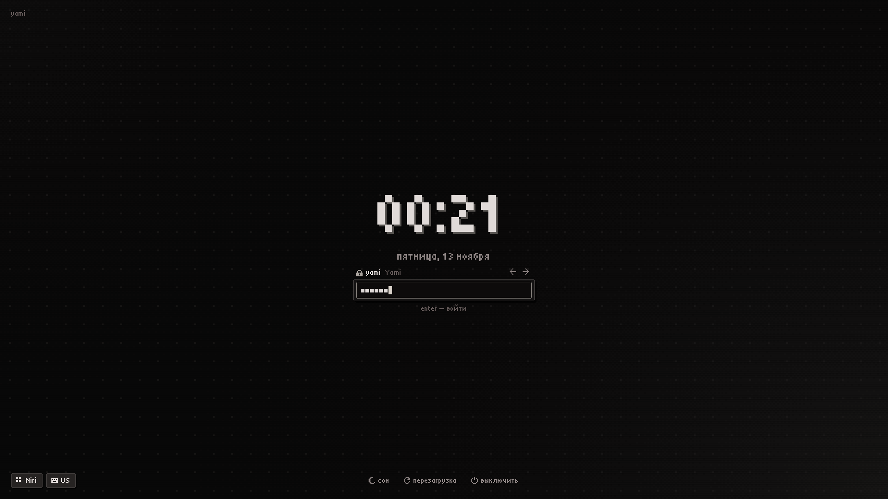

**yami-files** · миниатюры, места, вкладки и две панели; диалог файлов для всех программ

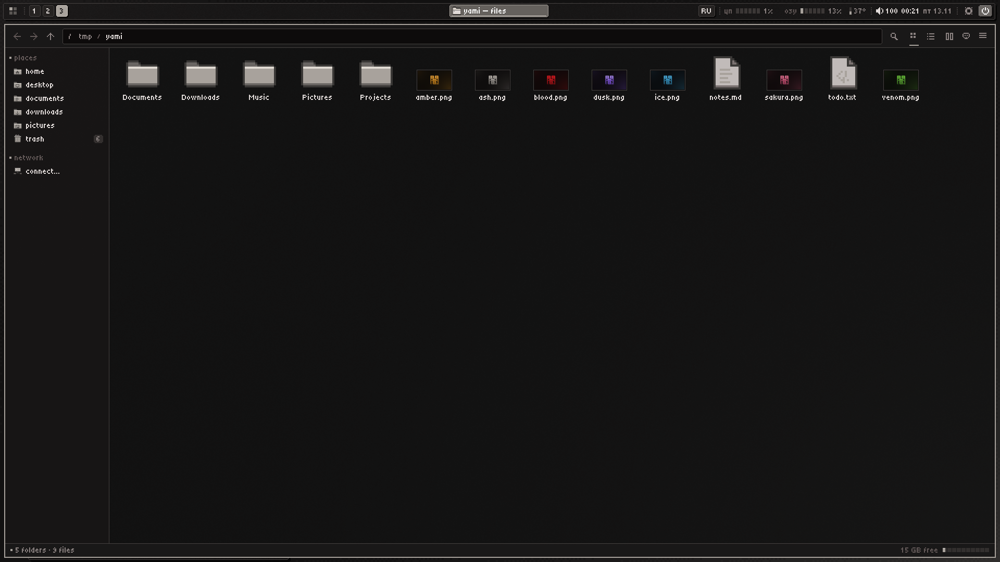

**Скриншоты** · область, окно или экран, потом стрелки, рамки, маркер, мозаика и номерки

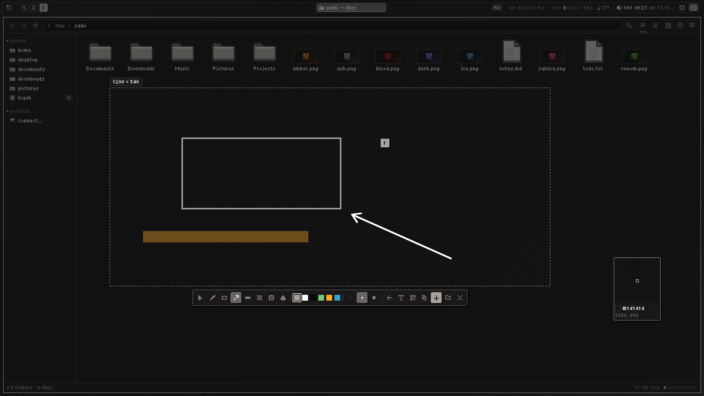

**Настройки → цвет** · семь палитр или свой акцент — за ним перекрашивается весь стол

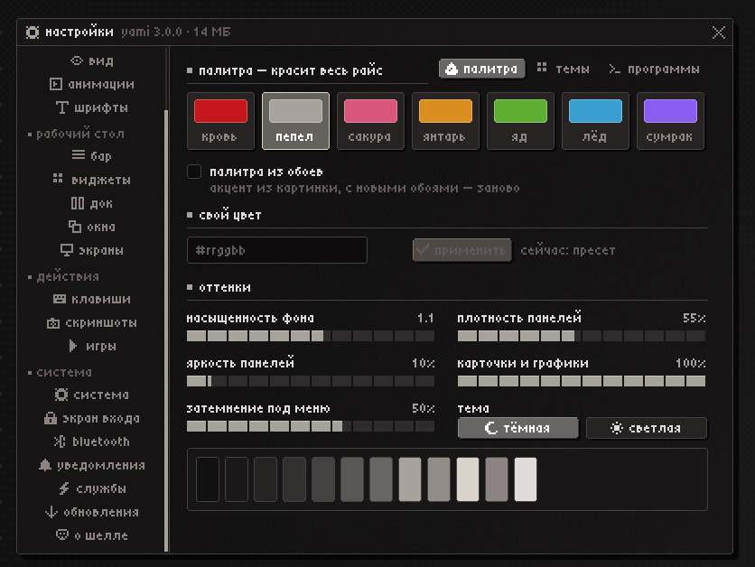

**Настройки → клавиши** · все сочетания по разделам, запись на лету

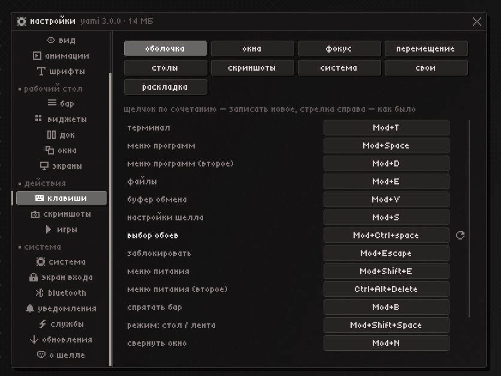

**yami-view** · честные пиксели при увеличении, быстрая правка, «сделать обоями»

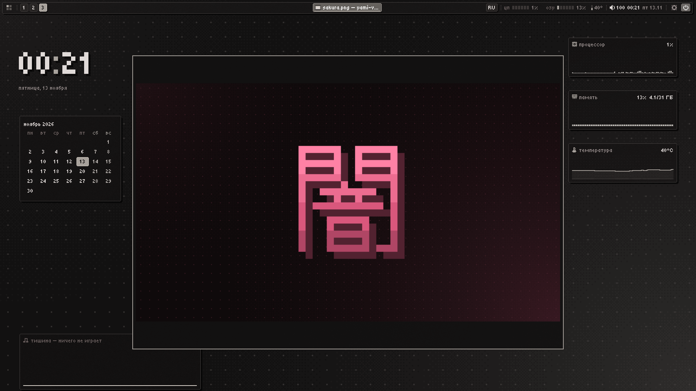

<details>
<summary><b>Ещё скриншоты</b></summary>

**Настройки → обновления** · выпуски, подписи, откат

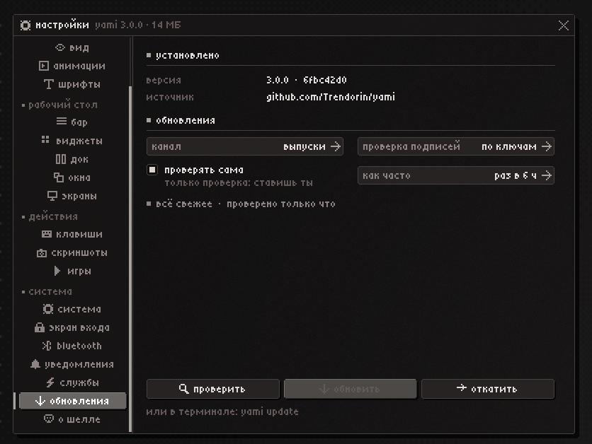

**Настройки → службы** · любую можно отдать другой программе

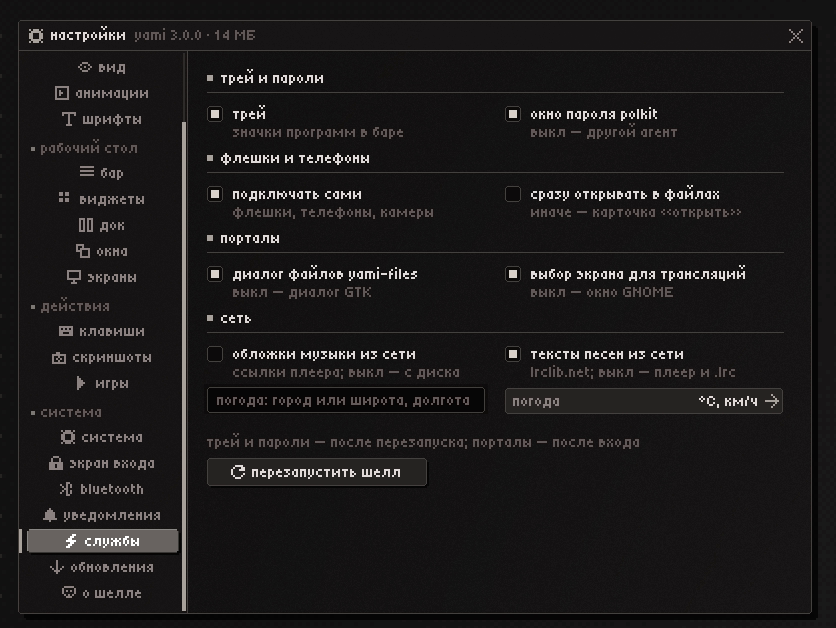

**Звук** · выходы, громкость, микрофон

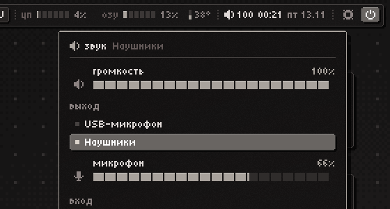

**Рабочий стол** · бар, виджеты и меню программ на пиксельных обоях

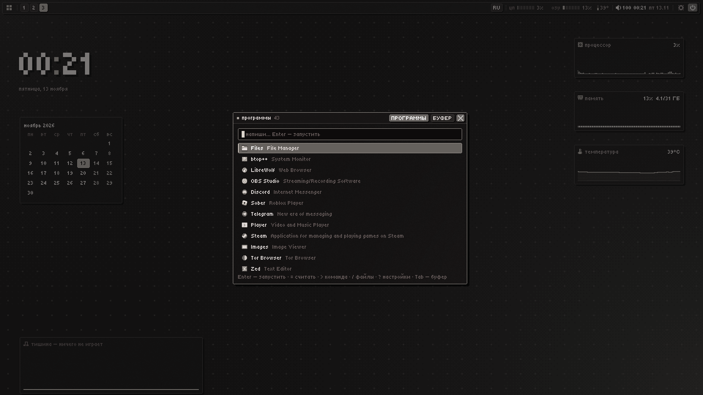

</details>

## Установка

Одна команда на чистой системе (скачивает репозиторий в `~/.local/share/yami/src` и запускает
установщик оттуда):

```sh
bash <(curl -fsSL https://raw.githubusercontent.com/Trendorin/yami/main/install.sh)
```

или из клона: `git clone https://github.com/Trendorin/yami yami && yami/install.sh`.

На x86_64 с glibc 2.34 или новее (Ubuntu 22.04, Debian 12, Fedora 35 и всё новее) выпуск ставит готовые бинарники
с проверенной подписью: без компилятора, за несколько минут. На остальных системах собирает из исходников. Где в
дистрибутиве ещё нет niri 26.04 или новее (Debian 13, Ubuntu 26.04), niri и xwayland-satellite один раз собираются из исходников:
нужен компилятор и около получаса. Пакеты для
Arch, Debian, Fedora, Gentoo и Nix: [docs/PACKAGING.ru.md](docs/PACKAGING.ru.md).

Он ставит только основу: niri, шелл, терминал и то, без чего рабочий стол не запустится. Запускай от себя, не
через sudo: пароль он спросит сам, один раз и там, где нужно, а перед началом скажет, сколько это займёт времени и
места на диске. Потом выйди из системы и выбери сеанс **Niri** (нет экрана входа — набери `niri-session` в консоли).
Там встретит первая настройка: одна тема на экран, а все её настройки — по кнопке: язык и стиль, цвет, обои, вид, шрифты, бар,
док, виджеты, окна, клавиши, niri, уведомления и службы, потом какие [модули](#модули) добавить. Открыть её снова
можно в любой момент: `yami setup`. Та же команда, запущенная позже, обновит и починит
то, что стоит, и сохранит твой выбор.

Для обычной установки флаги не нужны; они для остального:

| Флаг | Что делает |
|---|---|
| `--yes` | без вопросов |
| `--full` | всё сразу, без первой настройки при первом входе |
| `--apply "files view …"` | поставить ровно эти модули (так работает первая настройка) |
| `--lang en\|ru\|pt-BR\|es\|de\|fr\|uk\|pl` | язык установщика, шелла и подсказок клавиш |
| `--palette ID` | `blood` `ash` `sakura` `amber` `venom` `ice` `dusk` |
| `--look ID` | панели: `matte` `glass` `light` `solid` |
| `--font sans\|pixel` | шрифт программ: обычный (по умолчанию) или пиксельный Tiny5 везде |
| `--fetch mini\|full` | fastfetch: кто, система и стол (по умолчанию) или ещё и железо |
| `--no-ID`, `--ID` | вместе с `--full`: модуль выключить или включить |
| `--restyle СПИСОК` | что yami перекрашивает: `all`, `none` или список из `gtk` `qt` `cursor` `kitty` `fastfetch` `btop` `firefox` `mangohud` `foot` `cava` `starship`; чего нет в списке, yami не трогает (потом: настройки → цвет → программы) |
| `--no-sudo` | только домашняя папка: без пакетов и системных файлов |
| `--from-source` | собрать всё здесь вместо готовых бинарников выпуска |
| `--main` | самое свежее из ветки разработки вместо последнего выпуска (собирается из исходников) |
| `--prebuilt DIR\|URL` | взять готовые бинарники из этой папки или по этому адресу |
| `--dry-run` | показать план, ничего не менять |
| `--no-count` | не добавлять эту машину в значок «установки» (один анонимный запрос, [подробности](docs/SECURITY.ru.md#счётчик-установок)); `DO_NOT_TRACK=1` делает то же |
| `--uninstall` | удалить yami и его модули, вернуть копии и прежний менеджер входа |
| `--update` | пересобрать из этого дерева с сохранением настроек, без sudo (так работает `yami update apply`) |
| `--no-anim` | без анимаций установщика |

Что делает установка основы:

1. Определяет дистрибутив по `/etc/os-release` и ставит родным менеджером пакетов niri, порталы,
   polkit, PipeWire, NetworkManager, BlueZ, power-profiles-daemon, шрифты Noto, cliphist, grim, kitty, btop и ночной свет.
   Чего нет в репозиториях, о том сообщает, но не падает. Включает Bluetooth и профили питания, а
   NetworkManager — если сетью больше ничего не управляет.
2. Кладёт готовые бинарники выпуска в `~/.local/bin`, проверив подпись, а если для этой системы их нет,
   собирает шелл через `cargo build --release --locked` (Rust ≥ 1.89; если в дистрибутиве старее,
   ставит rustup).
3. Ставит пиксельные шрифты (Tiny5, DotGothic16, Terminess).
4. Подключает yami к конфигу niri одной строкой include в его начале (конфиг остаётся твоим,
   написанное ниже строки побеждает); нет конфига или это нетронутый стартовый конфиг самого niri — пишет
   стартовый конфиг yami, а прежний файл оставляет рядом как `config.kdl.bak-yami-DATE`.

yami не лезет в драйверы и загрузку: никакого окружения драйвера для сеанса, опций модулей и
initramfs. Всё пишется в `~/.cache/yami/install.log`. На NixOS используй flake: модуль NixOS для
системной половины и модуль Home Manager для домашней
([docs/PACKAGING.ru.md](docs/PACKAGING.ru.md#nix)).

### Сборка шелла вручную

```sh
cd shell
cargo build --release --locked
install -Dm755 target/release/yami-shell ~/.local/bin/yami-shell
```

Библиотеки во время работы: `libxkbcommon`, `libpam`. Необязательные помощники: `pactl`/`parec`
(громкость, микшер, эквалайзер), `playerctl` (музыка), `nmcli` (Wi-Fi), BlueZ (Bluetooth),
`cliphist` и `wl-clipboard` (буфер обмена). Python больше нигде не нужен: вывод палитры встроен в шелл.

## Модули

Программы вокруг шелла — отдельные, каждая в своём репозитории. Первая настройка добавляет и убирает
их, и любая работает без шелла yami: бери в свой райс одним файлом: `./yami-files install`, root не
нужен. Собственные службы шелла, yami-agents (окна паролей polkit и дисков, выбор экрана и портал
показа, автоподключение), приходят с шеллом из этого репозитория; они работают отдельным процессом,
так что перезапуск шелла никогда не обрывает трансляцию.

| Модуль | Что | Нужно |
|---|---|---|
| [yami-files](https://github.com/Trendorin/yami-files) | файловый менеджер, диалог файлов для всех программ, «показать в папке» | любой композитор Wayland |
| [yami-view](https://github.com/Trendorin/yami-view) | просмотр и быстрая правка картинок | любой композитор Wayland |
| [yami-play](https://github.com/Trendorin/yami-play) | плеер видео и музыки | libmpv |
| [yami-shot](https://github.com/Trendorin/yami-shot) | скриншоты: заморозить, выделить, разметить, прочитать текст и QR | layer-shell, grim |
| [yami-greet](https://github.com/Trendorin/yami-greet) | экран входа | greetd, niri |
| [yami-niri](https://github.com/Trendorin/yami-niri) | niri с tearing для игр и realtime-потоком | сборка из исходников |

Их системные пакеты ставятся вместе с ними: диски и телефоны (udisks2, gvfs) — с yami-files и шеллом,
распознавание текста и QR — с yami-shot. Если на машине есть Steam, первая настройка предложит и `games`
(GameMode, MangoHud).

Каждый модуль рисует через [yami-px](shell/px), библиотеку рисования в этом репозитории (модуль берёт
её по тегу `px-vX.Y.Z`), и читает один вид: `~/.config/yami/style.json`
для всех, `style.<module>.json` для того, чем отличается один. Вне yami модуль нейтрален: системный
шрифт, скруглённые углы, мягкие тени. Пиксельный вид шелла — пресет `yami`, а настроить можно
вплоть до каждого цвета: [docs/CONFIG.ru.md](docs/CONFIG.ru.md#вид-всех-модулей).

## Сколько потребляет

Замерено на этой машине (1920×1080, Arch; PSS — общие страницы библиотек делятся честно, в
скобках RSS):

| Что | Память |
|---|---|
| yami-shell в простое (бар, док, виджеты, уведомления, трей) | 12,5 МБ (16 МБ) |
| yami-shell с открытыми настройками | 18 МБ |
| yami-shell во время скриншота (замороженный кадр), после закрытия | 32 МБ → 16 МБ |
| yami-files --portal (диалог выбора файлов + FileManager1, работает всегда) | 0,8 МБ (3,2 МБ) |
| окно yami-files на домашней папке | 11 МБ (14 МБ) — Dolphin: 69 МБ (161 МБ) |
| yami-view на PNG 1080p, соседние фото уже декодированы | 49 МБ (53 МБ) — Gwenview: 96 МБ (188 МБ) |
| бинарники на диске: шелл + файлы + просмотр + плеер | 8,7 + 6,4 + 2,3 + 1,6 МБ |

Постоянно работает около 13 МБ — шелл и портал вместе. Без GPU-контекста, тулкитов и
интерпретаторов: окна рисуются в разделяемую память и только когда что-то изменилось. Код,
который программа больше не исполняет (её старт, закрытое окно настроек), уходит обратно ядру.

## Клавиши

| Клавиши | Действие |
|---|---|
| `Mod+Space`, `Mod+D` | меню программ (`Tab` — буфер обмена) |
| `Mod+V` | буфер: `Ctrl+P` — закрепить, `Del` — удалить |
| `Mod+S` | настройки шелла |
| `Mod+T` | kitty |
| `Mod+Shift+Space` | режим «стол» ↔ лента |
| `Mod+N`, `Mod+Shift+N` | свернуть окно, вернуть последнее |
| `Mod+Q`, `Alt+F4` | закрыть окно |
| `Mod+F`, `Mod+Shift+F` | развернуть колонку, полный экран |
| `Mod+G` | окно плавающим / в ленту |
| `Mod+Tab` | обзор |
| `Alt+Tab`, ``Alt+` `` | недавние окна, окна той же программы |
| `Mod+1…9`, `Mod+Shift+1…9` | рабочий стол, перенести колонку туда |
| `Mod+стрелки`, `Mod+HJKL` | фокус; с `Ctrl` — переместить |
| `Print`, `Mod+Shift+S` | скриншот (оверлей); `Ctrl+Print` — монитор, `Alt+Print` — окно |
| `Mod+E` | yami-files |
| `Mod+Escape` | блокировка |
| `Mod+Shift+E`, `Ctrl+Alt+Del` | меню питания |
| `Mod+B` | спрятать бар |
| `Mod+Shift+/` | все клавиши |
| `Alt+Shift` | следующая раскладка (настройки → клавиши → раскладка) |

Это значения по умолчанию: любое меняется в настройках → клавиши (`yami-shell binds list` выводит
текущие).

В баре: ПКМ по пустому месту — панель управления; ЛКМ по окну — фокус, свернуть, вернуть; СКМ —
закрыть; ПКМ — меню окна. Колесо над
рабочими столами — переключение, над звуком — громкость. Трек открывает плеер (полосу позиции
можно тянуть — перемотка), ПКМ — пауза, СКМ — следующий; кнопка в шапке плеера переключает вид:
обложка с эквалайзером, обложка с текстом песни, только текст (с метками времени звучащая строка
подсвечена) и коротко.

## Команда `yami`

Одна команда на весь стол (`~/.local/bin/yami` — тот же бинарь, что `yami-shell`); `yami help`
печатает справку в цветах палитры, `yami help <команда>` — про одну команду.

```sh
yami open settings:keys       # launcher clipboard settings[:вкладка] power lock walls screenshot cal sound media net bt sys profile tray weather privacy
yami palette ash              # без аргумента — список палитр; свой цвет: '#3a9fd0'; или wallpaper
yami wallpaper ~/x.png        # свои обои; без пути — пиксельные из палитры
yami restart                  # перезапустить шелл (подождёт, пока в фокусе игра)
yami status                   # что работает: шелл, портал, niri, последняя проверка обновлений
yami doctor                   # какие программы и службы D-Bus есть, чего нет и что без этого не работает
yami doctor games             # ntsync, gamemode, MangoHud: что есть и как добавить
yami report                   # архив для issue: версии, doctor, журнал, конфиги без секретов
yami ocr картинка.png         # текст с картинки (как «текст» на скриншоте)
yami theme export ~/my.yami   # вид одним файлом (поставить: yami theme import ФАЙЛ или https-ссылка)
yami theme save night         # текущий вид — в свои темы (list | apply ИМЯ | remove ИМЯ)
yami templates                # собрать свои шаблоны и показать, что вышло (force ИМЯ перезаписывает один)
yami icons add ~/Downloads/set.tar.xz   # поставить набор значков или курсоров (yami icons ИМЯ, yami cursor ИМЯ)
yami export ~/all.yami        # все настройки одним файлом для новой системы (yami import ФАЙЛ)
yami version                  # все части, установленный коммит, канал обновлений
yami update                   # что нового; apply | list | to X.Y.Z | rollback | status | log | need
```

## Обновления

Настройки → обновления (или `yami update`) раз в сутки проверяют репозиторий и показывают
карточку, когда вышел выпуск; ставишь всегда ты сам. У обновлятора свой клон в
`~/.local/share/yami/src`: новая версия ставится через `install.sh --update` (готовые бинарники, где они подходят, иначе сборка)
(настройки остаются, sudo не нужен). Пока всё не соберётся, ничего не меняется, неудачное обновление само всё
возвращает, а `yami update rollback` вернёт программы и конфиги, что стояли до последнего обновления. Каналы:
**выпуски** (теги `vX.Y.Z`) или **каждый коммит** ветки `main`. Пока идёт установка, во вкладке —
мини-консоль с логом и полоса прогресса. Обновлению sudo не нужен, поэтому если новой версии нужны
пакеты (помощник новой функции), вкладка показывает их с кнопкой **поставить**: одна команда `sudo`
в терминале (`yami update need`, видно и в `yami doctor`).

Откат — выбор, а не один щелчок: **откатить** открывает список с прошлой сборкой (сразу) и
подписанными выпусками (`yami update list`, `yami update to 2.1.0`), а начинает только
**поставить**. Настройки, которых старая версия не знает, откладываются и возвращаются при
следующем обновлении; после любого перехода обновлятор следит, чтобы шелл был запущен.

Выпуски подписываются: как только в `keys/allowed_signers` есть ключ автора, установленная версия
принимает только теги, подписанные им, — тег без ключа (запушенный или переписанный) не встанет.
Для автора:

```sh
tools/release.sh --keygen     # один раз: ssh-ключ подписи, доверенный в keys/allowed_signers (закоммитить)
tools/release.sh 3.1.0        # сначала всё делается и подписывается здесь (changelog, версии, модули, бинари, пакеты), потом «опубликовать?»
tools/release.sh --undo 3.1.0 # забирает назад выпуск, сделанный здесь и не опубликованный
```

Обновления приходят из этого репозитория по HTTPS; чтобы следить за своим форком — ключ `updateRepo`.

## Настройка

Всё из настроек (`Mod+S`) — это ещё и ключи в `~/.config/yami/shell.json`; файл перечитывается на
лету, если править его руками, а одно неверное значение заменяется значением по умолчанию, а не
сбрасывает весь файл. Полный справочник — [docs/CONFIG.ru.md](docs/CONFIG.ru.md). Из терминала:

```sh
yami-shell config list                 # все ключи, * — то, что отличается от умолчания
yami-shell config set dockSide '"left"'
yami-shell config set binds '{"terminal": "Mod+Return"}'
yami-shell config check                # негодные значения и неизвестные ключи
yami-shell binds list                  # клавиши: id, сочетание, действие
```

- **Вкладки настроек**: цвет, обои, вид, анимации, шрифты, бар (край экрана — на схеме, фишки модулей и
  разделители перетаскиваются; отступы у краёв, между модулями и у окон — стрелками), виджеты,
  док, окна (отступы между окнами и от краёв экрана, правила плавающих, курсор), экраны, клавиши,
  скриншоты, игры, система, экран входа, Bluetooth, уведомления (где карточки и OSD — на схеме),
  службы (трей, polkit, порталы, обложки — каждую можно отдать другой программе), обновления.
- **niri**: твой `~/.config/niri/config.kdl` остаётся твоим: yami добавляет одну строку include в
  его начало (`yami niri connect`, `yami niri disconnect` убирает её), и написанное ниже побеждает.
  Строка приносит `~/.config/yami/niri/yami.kdl`: клавиши шелла (`binds.kdl`), правила окон,
  размытие и игры (`rules.kdl`), цвета и курсор, экраны (`outputs.kdl`) и вид niri от yami
  (`base.kdl`); каждая часть включается в настройках → система → niri.
- **IPC**: `yami-shell msg <команда>`, где команда — `launcher`, `clipboard`, `power`, `settings`,
  `lock`, `bar`, `stacking`, `minimize`, `restore`, `edit`, `reload`, `restart`, `quit`, `settings ВКЛАДКА`, `profile`
  (следующий профиль питания), `popup cal|sound|media|net|bt|sys|profile|tray`, `screenshot [area|window|screen]`,
  `walls` (выбор обоев), `wallpaper [ПУТЬ]` (без пути — пиксельные обои из палитры), `curtain [on|off]` (шторка для трансляций), `cast-hide` (щелчок по окну: его программа чёрная в трансляциях или снова видна), `night` (ночной свет вкл/выкл),
  `media play-pause|next|previous|player` (плееру, что показан в баре; `player` переключает на следующий, как клик по его имени в окне музыки).
- **yami-files**: `~/.config/yami/files.json` (или ≡ → настройки). `yami-files --pick open|save|dir …`
  — диалог, который запускает портал; `yami-files --portal` — служба портала и FileManager1,
  её запускает D-Bus; `yami-files --portal-reload` передаёт её только что установленному
  бинарнику, не обрывая запись (это делает установщик).
- **Экран входа**: `install-system.sh` модуля yami-greet собирает его и ставит на работающую систему
  (один раз sudo), greetd — со следующей загрузки; первая настройка делает то же. `yami login sync` сразу отдаёт ему вид шелла (шелл делает это при каждой смене).

## Состав репозитория

| Путь | Что |
|---|---|
| `shell/` | yami-shell, Wayland-шелл на Rust (рабочая область cargo) |
| `modules.lock` | какую версию каждого модуля ставит эта версия шелла |
| `config/portal/` | какой бэкенд портала что обслуживает |
| `config/niri/` | конфигурация niri (клавиши приходят от шелла) |
| `config/kitty/`, `config/fontconfig/` | терминал и отрисовка пиксельных шрифтов |
| `shell/px`, `shell/agents` | yami-px, библиотека рисования всех модулей; yami-agents, службы шелла |
| `tools/apply-theme.sh` | шрифты и стиль Qt и GTK |
| `fonts/` | пиксельные шрифты в комплекте (SIL OFL) |
| `install.sh`, `installer/` | установщик: вход и порядок шагов, по файлу на каждую задачу |
| `flake.nix`, `nix/` | пакет Nix и модули NixOS и Home Manager |
| `docs/` | справка по настройкам, заметки о безопасности, упаковка и Nix (и по-русски: `*.ru.md`) |
| `keys/` | ключи подписи выпусков (`allowed_signers`), их читают `yami update` и установщик |
| `VERSION`, `CHANGELOG.md` | версия выпуска и что менялось в каждом (`CHANGELOG.ru.md` по-русски) |

## yami-niri

Официальный niri v26.04 и короткая серия патчей, собранные на твоей машине. Живёт в своём
[репозитории](https://github.com/Trendorin/yami-niri); первая настройка собирает и включает его, вручную — из его клона:

```sh
./yami-niri.sh build     # скачать, наложить патчи, собрать (5–25 мин), включить со следующего входа
./yami-niri.sh status    # какой niri запустится при следующем входе
./yami-niri.sh off       # вернуться на niri из пакета
```

Сеанс запускает его через обёртку, которая откатывается на niri из пакета, если форк не принял
конфиг или упал сразу после старта. Если сеанс всё равно не поднимается: `Ctrl+Alt+F3`, войди,
`~/.local/lib/yami-niri/yami-niri.sh off`.

## Разработка

| Команда | Что делает |
|---|---|
| `tools/check.sh` | сборка без предупреждений, проверки перевода, английские и русские документы в одном виде (`yami-dev check-docs`), синтаксис скриптов, конфиг niri, пробный прогон установщика (то же гоняет CI) |
| `tools/map.sh [ТЕКСТ]` | все исходники с описанием в одну строку |
| `yami-shell shot [ЦЕЛЬ…] --lang en [--transparent] -o ПАПКА` | панели в PNG без композитора; падает на непереведённых надписях |
| `yami-agents shot`, `yami-files shot`, `yami-view shot`, `yami-play shot`, `yami-shot shot` | то же для каждого модуля (первая настройка — цели шелла `welcome:STEP`) |
| `tools/check-modules.sh [ИМЯ…]` | все модули рядом с этим репозиторием: без предупреждений, тесты, переводы, каждое состояние в обоих видах и на всех языках, каждая надпись влезает |
| `yami-greet shot -o DIR`, `yami-greet --demo` | экран входа offscreen во всех состояниях; `--demo` запускает его без greetd (пароль `yami`) во вложенном niri |
| `yami-dev readme-art`, `tools/readme-shots.sh` | логотип и карточки README; настоящие скриншоты твоего сеанса (пустой стол, простые имена устройств, всё возвращается) |
| `tools/release.sh X.Y.Z` | выпуск: сначала всё делается и подписывается здесь (changelog, версии, теги изменённых модулей, бинари, пакеты), потом один вопрос перед публикацией; `--push`, `--status`, `--undo`, `--keygen` — один раз для ключа |
| `tools/deploy.sh` | собрать, поставить в `~/.local/bin` и перезапустить шелл (не трогает, пока в фокусе игра); `--modules` — ещё и модули рядом с этим репозиторием, `--modules-only` — только они |

## Спасибо

- [Minish777](https://github.com/Minish777) ищет баги и недоделки и описывает их вместе с
  вариантами исправления: переключение плееров, текст песен, выбор обоев, плавающий бар, погода,
  шаблоны программ и многое другое начались с этих отчётов, как и разбор шаблонов (#27), модуль
  окон в любой группе бара (#28) и палитра из обоев (#26).

## Сделано с Claude

yami пишется с помощью [Claude](https://claude.ai) от Anthropic, через Claude Code: большая часть
кода, патчей yami-niri и документации появилась в этих сессиях. Каждое изменение по-прежнему
собирается, проверяется (`tools/check.sh`) и каждый день работает на настоящей машине, прежде чем
выйти в релиз.

## Лицензия

Код — MIT, см. [LICENSE](LICENSE). Его можно брать, менять и распространять, в том числе в своих
проектах, если в каждой копии и в каждой существенной части сохранены строка копирайта и текст
лицензии. У шрифтов в комплекте свои лицензии (SIL Open Font License, тексты в `fonts/`).
Monocraft скачивается из официального релиза во время установки (версия закреплена, сверяется
SHA-256). yami-niri собирается из официального niri (GPL-3.0) с патчами из
репозитория yami-niri.

Лицензия — на код, прав на имя проекта она не даёт: форк или пересборка выходит под своим именем
и логотипом и не выдаёт себя за yami или за работу его авторов.
